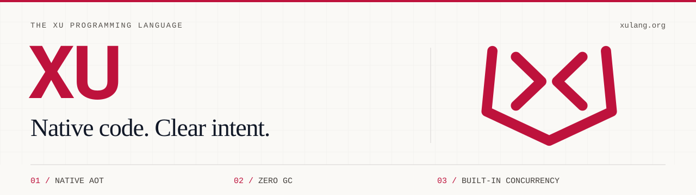

<p align="center">
  <a href="https://xulang.org/de">
    <picture>
      <source media="(prefers-color-scheme: dark)" srcset="https://raw.githubusercontent.com/xulang-org/xulang-org/main/brand/xu-profile-dark.svg">
      
    </picture>
  </a>
</p>

<h1 align="center">Die Programmiersprache XU</h1>

<p align="center">
  Eine Systemsprache mit nativer Kompilierung, Eigentumsmodell und integrierter Nebenläufigkeit.<br>
  <strong>Deterministische Speicherverwaltung. Kein Garbage Collector.</strong>
</p>

<p align="center">
  <a href="https://xulang.org/de/playground"><strong>Im Browser ausprobieren</strong></a> &nbsp; · &nbsp;
  <a href="https://xulang.org/de/docs/start">Leitfaden lesen</a> &nbsp; · &nbsp;
  <a href="https://xulang.org/de/download">XU herunterladen</a> &nbsp; · &nbsp;
  <a href="https://github.com/xulang-org/xu">Compiler-Quellcode</a>
</p>

<p align="center">
  <a href="README.md">English</a> / <a href="README.zh-CN.md">简体中文</a> / <a href="README.zh-TW.md">繁體中文</a> / <a href="README.ja.md">日本語</a> / <a href="README.ko.md">한국어</a> / <a href="README.es.md">Español</a> / <a href="README.fr.md">Français</a> / <strong>Deutsch</strong> / <a href="README.ru.md">Русский</a> / <a href="README.pt-BR.md">Português</a>
</p>

## Eine kompakte Sprache mit klarem Kontrollfluss

XU vereint zur Kompilierzeit geprüfte Ownership- und Borrowing-Regeln mit leichtgewichtigen Koroutinen und typisierten Kanälen. Der Code wird Ahead-of-Time (AOT) in nativen Maschinencode oder WebAssembly kompiliert, während Ressourcenlebensdauern deterministisch verwaltet werden.

| Sprachdesign | Was es Ihnen bietet |
| :--- | :--- |
| **Ownership ohne GC** | Move- und Borrow-Prüfungen zur Kompilierzeit, inferierte Lebensdauern und deterministische Ressourcenfreigabe. |
| **Nebenläufigkeit in der Sprache** | Starten Sie eine Koroutine mit `xu` und tauschen Sie Werte über typisierte `chan`-Kanäle aus. |
| **Sichtbarer Kontrollfluss** | `<<` gibt einen Wert zurück, `>>>` meldet einen Fehler und `>>> (err) { … }` behandelt ihn direkt am Aufrufort. |
| **Integrierte Toolchain** | Bauen, ausführen, prüfen, testen, formatieren, Dokumentation erzeugen und Sprachdienste nutzen – alles über `xu`. |

## Ein wenig XU lesen

Zwei Worker, ein Kanal und ein expliziter Fehlerpfad:

```xu
@main
#errors

fn score(name string) int {
    if name.len == 0 { >> errors.new("empty name") }
    << name.len * 10
}

fn worker(name string, results chan int) {
    value := score(name) >>> (err) {
        results <- 0
        <<
    }
    results <- value
}

fn main() int {
    results := chan int{cap: 2}
    xu worker("hello", results)
    xu worker("world", results)
    println(<-results + <-results)
    << 0
}
```

Als `main.xu` speichern und `xu run main.xu` ausführen. Die Ausgabe lautet `100`.

`#errors` importiert ein Paket. `xu worker(...)` startet eine Koroutine. Die beiden Empfangsoperationen sammeln die Ergebnisse; schlägt `score` fehl, sendet `>>> (err) { … }` den Ersatzwert `0` und beendet diesen Worker.

## Hier starten

Erkunden Sie den [Browser-Playground](https://xulang.org/de/playground) ganz ohne Installation oder [laden Sie das SDK herunter](https://xulang.org/de/download) für die lokale Entwicklung. Nach der Installation:

```sh
xu --version
xu run main.xu
xu build main.xu -o hello
```

Lesen Sie weiter im [Einstiegsleitfaden](https://xulang.org/de/docs/start), in der [Sprachreferenz](https://xulang.org/de/docs/lang/syntax) oder in den [ausführbaren Beispielen](https://github.com/xulang-org/examples).

XU entwickelt sich aktiv in der **0.x-Reihe** weiter. Unter [Releases](https://github.com/xulang-org/xu/releases) finden Sie veröffentlichte SDKs und unter [Status und Einschränkungen](https://xulang.org/de/docs/status) die Plattform- und Laufzeitabdeckung. Das [Benchmark-Dashboard](https://xulang.org/de/benchmarks) dokumentiert gemessene Workloads, Compilerversionen und Quellenherkunft.

Verwenden Sie [API durchsuchen](https://xulang.org/api/), um ein Paket zu finden oder direkt zu einer Deklaration auf der aktuellen Seite zu springen. Drücken Sie `/` außerhalb eines Eingabefelds, um die Suche zu öffnen; Pfeiltasten und Enter navigieren durch die Treffer, Escape schließt das Feld. Das API-Verzeichnis klappt auf Mobilgeräten ein, damit der Inhalt erreichbar bleibt. Deklarationsüberschriften sind Permalinks, und „Copy link“ teilt die aktuelle Seite oder Deklaration.

Der API-Index bietet Schnellzugriffe für häufige Aufgaben, Themenbeschreibungen und direkte Paketsuche über Standardbibliothek, UI und Erweiterungen. Paketseiten beginnen mit einem Deklarations-Explorer: Filtern Sie nach Name, Zweck oder Art und springen Sie direkt zur vollständigen Signatur und Dokumentation. Zugehörige Quellbeispiele bleiben bis zum Öffnen eingeklappt.

## Das Ökosystem entdecken

| Projekt | Wohin |
| :--- | :--- |
| **Sprache & Compiler** | [xu](https://github.com/xulang-org/xu) — Self-Hosted-Compiler, Standardbibliothek und CLI-Werkzeuge. |
| **Durch Ausführen lernen** | [examples](https://github.com/xulang-org/examples) — Sprachgrundlagen, Nebenläufigkeit, Netzwerk, Datenbanken und UI-Beispiele. |
| **Bibliotheken & Integrationen** | [packages](https://github.com/xulang-org/packages) — Datenbanktreiber, Messaging, Speicher und Dienstintegrationen. |
| **Editor-Unterstützung** | [vscode-xu](https://github.com/xulang-org/vscode-xu) — Syntaxhervorhebung und XU-Sprachdienste für VS Code und Cursor. |
| **Leistung** | [bench](https://github.com/xulang-org/bench) — sprachübergreifende Workloads und reproduzierbare Benchmark-Quellen. |
| **Website & Dokumentation** | [xulang-org](https://github.com/xulang-org/xulang-org) — xulang.org, Dokumentation und WebAssembly-Playground. |

## XU gemeinsam weiterentwickeln

Probieren Sie ein Beispiel aus, melden Sie einen Compiler-Fehler, verbessern Sie die Dokumentation oder tragen Sie eine Bibliothek bei. Beginnen Sie bei den [Compiler-Issues](https://github.com/xulang-org/xu/issues) oder den [Website-Issues](https://github.com/xulang-org/xulang-org/issues).

Lesen Sie vor einem Beitrag den [Beitragsleitfaden](CONTRIBUTING.md) und die [gemeinsamen Repository-Regeln](.github/REPOSITORY_RULES.md). Maintainer können die [GitHub-Einstellungs-Checkliste](.github/GITHUB_SETTINGS.md) nutzen.

[Website](https://xulang.org/de) · [GitHub](https://github.com/xulang-org) · [X / @xulang_org](https://x.com/xulang_org) · [MIT-Lizenz](LICENSE)

---

<details>
<summary><strong>An xulang.org mitarbeiten</strong> — Website-Build, Playground und Deployment</summary>

Dieses Profil-Repository enthält zugleich den Quellcode der offiziellen Website. Die Website wählt das über `VERSION` festgelegte veröffentlichte **XU SDK** aus; Entwicklungs-Builds bleiben getrennt.

### Lokaler Build

Erfordert **Python 3.10+** ausschließlich mit der Standardbibliothek. Statische Builds und Tests laufen ohne XU, Node.js oder Geschwister-Checkouts.

```sh
make build                       # dist/ bauen und interne Links sowie Assets prüfen
make run                         # Vorschau unter http://127.0.0.1:8080
make run PORT=18080              # Vorschau auf benutzerdefiniertem Port
make check                       # Regressionstest-Suite der statischen Website ausführen
make build BASE_PATH=/xulang-org # Build für einen Projekt-Unterpfad
make clean                       # dist/ und build/playground/ entfernen
```

| Pfad | Zweck |
| :--- | :--- |
| `content/{en,zh,...}/` | Dokumentation, Tutorials, Blogbeiträge und API-Inhalte. |
| `templates/` | Seitenvorlagen, API-Leitfäden und Beispielauswahlen. |
| `www/` | Stile, Skripte, Schriften, Icons und statische Assets. |
| `playground/typed/` | In XU geschriebene Browser-WebAssembly-Laufzeit. |
| `scripts/` | Statischer Builder, API-Generator und Release-Validierung. |
| `tests/` | Regressionsabdeckung für statische Website, Playground und Kanäle. |
| `brand/` | Marken-Assets und Richtlinien für die visuelle Identität. |

Generierte Ausgaben landen in den ignorierten Verzeichnissen `dist/` und `build/`. Inhaltsfragmente deklarieren Titel per `<!--title: ...-->` und werden in Verzeichnisrouten wie `docs/start/index.html` gerendert.

### Gemeinsame Website-Metadaten

Status-Paketzahlen stammen aus den generierten Inventaren `content/{en,zh}/api/index.html`. Der Builder prüft, dass beide Inventare übereinstimmen und ihre Paketseiten vorhanden sind.

`templates/releases.json` speist die Versionshinweise, die jüngsten Release-Einträge im Blog-Index und die Release-Links in der Blog-Seitenleiste. Die manuelle Sprachauswahl wird in `localStorage` und einem einjährigen `SameSite=Lax`-Cookie gespeichert und zusätzlich per `?lang=...` unterstützt. Die Sitemap lässt `lastmod` bewusst aus, damit ein unveränderter Rebuild keine neuen Inhaltsänderungen vortäuscht.

### API-Inhalte und Beispiele

LLM-Leitfäden nutzen `templates/llms/*.md`, gemeinsame Website-Beispiele, `VERSION` und `www/benchmarks.json`. Führen Sie `python3 scripts/gen_llms.py` aus, um `www/llms*.txt` zu aktualisieren.

Redaktionelle Texte liegen in `templates/api-guides/{en,zh}/`, Funktionsverträge in `templates/api-contracts.json`. Prüfen Sie funktionslokale Beispiele mit dem passenden nativen Compiler:

```sh
python3 scripts/check-api-examples.py --xu /path/to/selected-sdk/bin/xu
```

Deklarationen und Beispiele aktualisieren:

```sh
make api XU_ROOT=/path/to/selected-sdk XU_PACKAGES_ROOT=/path/to/selected-sdk/packages \
  XU_EXAMPLES_ROOT=../examples XU_EXAMPLES_REF=FULL_EXAMPLES_COMMIT_SHA
```

Einzelne Projekte gezielt aktualisieren, ohne andere Release-Snapshots zu ersetzen:

```sh
python3 scripts/gen-api.py --src /path/to/selected-sdk/src --packages /path/to/selected-sdk/packages \
  --examples ../examples --examples-ref FULL_EXAMPLES_COMMIT_SHA \
  --examples-project examples/16_ui_webview/component_workshop \
  --examples-project examples/16_ui_webview/style_gallery
```

### WebAssembly-Playground

Verwenden Sie das passende SDK und Node.js 22+, um die XU-Laufzeit nach WebAssembly zu kompilieren und zu optimieren:

```sh
npm ci --ignore-scripts # Festgelegten WASM-Optimierer installieren
make wasm XU_ROOT=/path/to/released-sdk
make check-playground   # Echte WASM-Ausführung und Beispiele in Node.js prüfen
make check-chan         # Native Kanal-Beispiele mit XU prüfen
make build              # Laufzeit in dist/ bündeln
```

Der Playground läuft clientseitig im Browser. Dokumentation und Startseite laden kein WASM vorab. Der lineare Speicher startet mit der vom SDK ausgegebenen Größe und kann bis 256 MiB wachsen. `build/playground/build.json` erfasst Größen, Prüfsumme, Optimierereinstellungen und Speichergrenzen.

### Benchmarks und Deployment

Um Benchmarks zu aktualisieren, laden Sie einen vollständigen Sechs-Plattform-Actions-Lauf herunter und führen aus:

```sh
python3 scripts/import-benchmarks.py --artifacts DIR --bench-root PINNED_BENCH_CHECKOUT --commit FULL_SHA --run-id ID --date YYYY-MM-DD
python3 scripts/sync_all_benches.py --bench-root PINNED_BENCH_CHECKOUT
python3 scripts/gen-benchmarks.py
```

Die Version in `VERSION` steuert Downloads, API-Referenz und Browser-Laufzeit. Der Pages-Workflow prüft die SHA-256-Prüfsumme des veröffentlichten SDKs, testet dessen Ausgabe und deployt bei Pushes auf `main` zu GitHub Pages.

</details>

### UI-API und Beispiele

Der [englische UI-Leitfaden](content/en/docs/ui.html) und der [chinesische Leitfaden](content/zh/docs/ui.html) dokumentieren das in `VERSION` gewählte offizielle Xu SDK. Alle sechs Pakete — `ui`, `ui/draw`, `ui/layout`, `ui/chart`, `ui/widgets` und `ui/webview` — erscheinen in der veröffentlichten API-Navigation.

Für eine künftige unveröffentlichte API unterstützt der Generator weiterhin eine explizite Entwicklungsvorschau, ohne das gewählte Release zu ändern:

```sh
python3 scripts/gen-api.py --src /path/to/development-sdk/src --preview --package ui
make build
make check
```

Der Browser-Playground enthält eine [dreiseitige Steuerelement-Galerie](https://xulang.org/de/playground?example=ui-gallery), in der gemeinsame Desktop-Xu-Logik in WASM auf Canvas gerendert wird. Siehe den [Leitfaden zum Browser-UI-Build](playground/README.md) für Quellsynchronisation, unterstützte APIs, Tastatursteuerung und Replay-Grenzen.

Die Widgets-Dokumentation folgt **API → UI → Widgets → Komponente** mit 46 interaktiven Komponentenseiten, deren Quellen in `playground/examples/widget-*.xu` liegen und per `python3 scripts/gen-widget-examples.py` veröffentlicht werden.

Der [Browser-UI-Leitfaden](https://xulang.org/de/docs/ui/#browser-playground) behandelt ComboBox-Kandidaten, MultiSelect-Checkboxen, Popover-Einstellungen und Modal-Fokusbehandlung.
