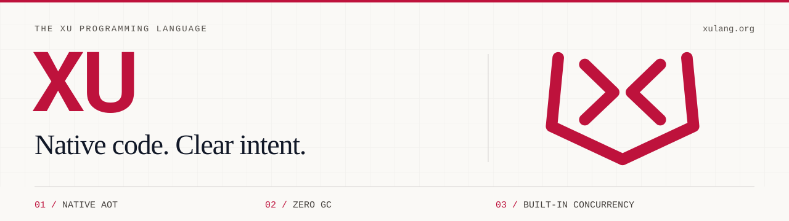

<p align="center">
  <a href="https://xulang.org/zh">
    <picture>
      <source media="(prefers-color-scheme: dark)" srcset="https://raw.githubusercontent.com/xulang-org/xulang-org/main/brand/xu-profile-dark.svg">
      
    </picture>
  </a>
</p>

<h1 align="center">XU 编程语言</h1>

<p align="center">
  一门融合原生编译、所有权与内置并发的系统编程语言。<br>
  <strong>确定性内存管理，无垃圾回收器。</strong>
</p>

<p align="center">
  <a href="https://xulang.org/zh/playground"><strong>在线体验</strong></a> &nbsp; · &nbsp;
  <a href="https://xulang.org/zh/docs/start">阅读指南</a> &nbsp; · &nbsp;
  <a href="https://xulang.org/zh/download">下载 XU</a> &nbsp; · &nbsp;
  <a href="https://github.com/xulang-org/xu">编译器源码</a>
</p>

<p align="center">
  <a href="README.md">English</a> / <strong>简体中文</strong>
</p>

## 简洁的语言，清晰的流向

XU 将编译期所有权与借用检查、轻量协程和强类型信道结合在一起。源码通过 AOT 编译为原生机器码或 WebAssembly，资源按生命周期确定性释放。

| 语言设计 | 带来的体验 |
| :--- | :--- |
| **所有权，无 GC** | 编译期检查移动与借用，推导生命周期，确定性回收资源。 |
| **语言内置并发** | 用 `xu` 启动协程，通过强类型 `chan` 信道传递值。 |
| **看得见的控制流** | `<<` 返回、`>>` 抛错，`or (err) { … }` 在调用处处理错误。 |
| **集成的工具链** | 通过 `xu` 完成构建、运行、检查、测试、格式化、文档生成与语言服务。 |

## 读一段 XU

两个工作协程、一个信道，以及明确的错误处理路径：

```xu
@main
#errors

fn score(name string) int {
    if name.len == 0 { >> errors.new("empty name") }
    << name.len * 10
}

fn worker(name string, results chan int) {
    value := score(name) or (err) {
        results <- 0
        <<
    }
    results <- value
}

fn main() int {
    results := chan int{cap: 2}
    xu worker("hello", results)
    xu worker("world", results)
    println(<-results + <-results)
    << 0
}
```

保存为 `main.xu`，执行 `xu run main.xu`，输出 `100`。

`#errors` 导入包，`xu worker(...)` 启动协程，两次信道接收汇总结果。若 `score` 失败，`or (err) { … }` 会发送兜底值 `0`，然后结束当前工作协程。

## 从这里开始

无需安装，直接打开 [浏览器演练场](https://xulang.org/zh/playground)；也可以 [下载 SDK](https://xulang.org/zh/download)，在本地开发。安装后运行：

```sh
xu --version
xu run main.xu
xu build main.xu -o hello
```

接着阅读 [入门指南](https://xulang.org/zh/docs/start)、[语言参考](https://xulang.org/zh/docs/lang/syntax)，或运行 [官方示例](https://github.com/xulang-org/examples)。

XU 正在 **0.x 阶段**持续演进。已发布 SDK 见 [Releases](https://github.com/xulang-org/xu/releases)，平台与运行时覆盖见 [限制与现状](https://xulang.org/zh/docs/status)。[基准看板](https://xulang.org/zh/benchmarks) 保留实测负载、编译器版本与源码来源。

打开 [API 文档](https://xulang.org/zh/api/)，使用「搜索 API」查找包或直达本页声明。在输入框外按 `/` 打开搜索，方向键和 Enter 操作结果，Escape 关闭。手机上目录默认收起，便于直接阅读正文；声明标题可直达对应位置，「复制链接」可分享当前页面或声明。

## 探索生态

| 项目 | 入口 |
| :--- | :--- |
| **语言与编译器** | [xu](https://github.com/xulang-org/xu) — 自举编译器、标准库与命令行工具。 |
| **从示例入手** | [examples](https://github.com/xulang-org/examples) — 语法基础、并发、网络、数据库与 UI 示例。 |
| **库与服务集成** | [packages](https://github.com/xulang-org/packages) — 数据库驱动、消息队列、存储与服务集成。 |
| **编辑器支持** | [vscode-xu](https://github.com/xulang-org/vscode-xu) — VS Code 与 Cursor 的语法高亮和 XU 语言服务。 |
| **性能与横测** | [bench](https://github.com/xulang-org/bench) — 跨语言负载与可复现的基准源码。 |
| **官网与文档** | [xulang-org](https://github.com/xulang-org/xulang-org) — xulang.org、文档中心与 WebAssembly 演练场。 |

## 一起建设 XU

运行一个示例、反馈编译器问题、完善文档，或贡献一个库。可以从 [编译器 Issues](https://github.com/xulang-org/xu/issues) 和 [官网 Issues](https://github.com/xulang-org/xulang-org/issues) 开始。

参与开发前请阅读 [贡献指南](CONTRIBUTING.md) 与 [统一仓库管理规范](.github/REPOSITORY_RULES.md)；维护者可按 [GitHub 配置清单](.github/GITHUB_SETTINGS.md) 启用并验收后台规则。

[官网](https://xulang.org/zh) · [GitHub](https://github.com/xulang-org) · [X / @xulang_org](https://x.com/xulang_org) · [MIT 许可证](LICENSE)

---

<details>
<summary><strong>参与 xulang.org 开发</strong> — 网站构建、演练场与部署</summary>

这个主页仓库也保存了官网源码。站点使用 `VERSION` 指定的已发布 **XU SDK**，开发版另行迭代。

### 本地构建

需要 **Python 3.10+**，仅使用标准库。静态构建与检查无需 XU、Node.js 或相邻仓库。

```sh
make build                       # 构建 dist/，校验内部链接与资源
make run                         # 预览：http://127.0.0.1:8080
make run PORT=18080               # 指定预览端口
make check                       # 执行静态站点回归检查
make build BASE_PATH=/xulang-org  # 构建到项目子路径
make clean                       # 清理 dist/ 与 build/playground/
```

| 路径 | 用途 |
| :--- | :--- |
| `content/{en,zh}/` | 文档、教程、博客与 API 正文。 |
| `templates/` | 页面模板、API 手写指南与示例选择配置。 |
| `www/` | 样式、脚本、字体、图标与静态资源。 |
| `playground/runtime/` | 使用 XU 编写的浏览器 WebAssembly 运行器。 |
| `scripts/` | 静态构建、API 生成与发布校验。 |
| `tests/` | 站点、演练场与信道回归检查。 |
| `brand/` | 品牌物料与视觉识别规范。 |

产物输出至已忽略的 `dist/` 与 `build/`。正文片段通过 `<!--title: ...-->` 声明标题，生成 `docs/start/index.html` 等目录路由。

### 共享站点元数据

状态页的包数来自生成的 `content/{en,zh}/api/index.html` 清单。构建器检查中英清单相同且包页面存在；控件详情与开发预览页不计入包数。新增包时通过 API 生成器更新清单。

`templates/releases.json` 同时提供中英版本记录、博客索引的近期发布条目与侧栏发布链接。新增版本时更新此文件，并新增对应的双语博文；较早的历史博文仍由正文维护。首页横幅、页头和页脚不显示 SDK 补丁版本；下载、文档与 API 区保留版本身份，结构化软件元数据仍准确标识选定 SDK。

手动选择语言将 `xu-lang=en` 或 `xu-lang=zh` 写入 localStorage 及有效期一年的 SameSite=Lax cookie。localStorage 按来源共享，cookie 的路径限定在部署前缀。语言链接还附带 `?lang=en` 或 `?lang=zh`，因此存储被禁用时本次选择仍生效。优先级为有效查询参数、localStorage、cookie；只有英文首页入口会自动选择中文，先遵循已存选择，再参考简体中文浏览器语言。若所有存储都被禁用，之后不带查询参数的访问将再次使用浏览器语言。

sitemap 有意省略 `lastmod`：检出时间和 API 重新生成时间不能证明编辑日期，重复构建不应制造内容更新。只有具备可靠的逐页内容历史（包含共享依赖）后才应添加日期。

### API 内容与示例

手写说明保存在 `templates/api-guides/{en,zh}/`，生成时与所选 SDK 的公开声明合并。示例从官方 examples 仓库的固定提交导入；`www/api-examples/` 中的快照支持本地与 CI 独立构建。

逐函数说明保存在 `templates/api-contracts.json`，按包、接收者类型和名称定位。中英内容须说明具体用途、参数含义和返回行为；`notes` 补充边界与前提，`errors` 说明错误处理，`examples` 保存可独立运行的本机 SDK 程序和可选的预期 `output`。反引号表示行内代码。类型成员分别显示为公开字段或要求的方法，避免与函数参数混淆。

经过源码核对的条目保存 `source_sha256`（签名与函数体）和 `package_sha256`（含私有辅助函数的包源码）。任一摘要变化都会阻止生成；先重新核对行为并更新说明，再刷新摘要。参数名与手写示例字段也会在写页面前校验。用匹配的原生编译器验证函数旁的示例：

```sh
python3 scripts/check-api-examples.py --xu /path/to/selected-sdk/bin/xu
```

LLM 文档使用 `templates/llms/*.md`、站点共享示例、`VERSION` 与 `www/benchmarks.json`。静态构建按选定 SDK 身份生成文档；运行 `python3 scripts/gen_llms.py` 更新已跟踪的 `www/llms*.txt` 副本。

刷新声明与示例时，在 `templates/api-examples.json` 中选择兼容源码，用所选 SDK 检查，再指定示例仓库及完整提交 SHA：

```sh
make api XU_ROOT=/path/to/selected-sdk XU_PACKAGES_ROOT=/path/to/selected-sdk/packages \
  XU_EXAMPLES_ROOT=../examples XU_EXAMPLES_REF=FULL_EXAMPLES_COMMIT_SHA
```

所选文件必须与该提交一致。未提供两个示例变量时，`make api` 复用并校验已有快照。原生示例使用本地 SDK 运行。

### WebAssembly 演练场

使用匹配的 SDK 和 Node.js 22+ 将 XU 运行器编译并优化为 WebAssembly。
锁文件固定构建时使用的 Binaryen 优化器；只构建静态站点仍仅需 Python。

```sh
npm ci --ignore-scripts # 安装固定版本的 WASM 优化器
make wasm              # 编译 build/playground/xu-play.wasm
make check-playground  # 在 Node.js 中检查真实 WASM 与示例执行
make check-chan        # 使用 XU 检查原生信道示例
make build             # 将运行器打包到 dist/
```

演练场在浏览器客户端运行。阅读文档或仅打开首页不会预加载 WASM。首次运行时，页面下载模块并异步编译，再将编译结果交给 worker 实例化和执行 Xu。编译结果在当前页面内复用；初始化失败可以重试，停止或切换程序会取消旧 worker 的初始化。

运行器线性内存从 32 MiB 开始，最多增长到 256 MiB，与下载体积分别计算。`build/playground/build.json` 记录实际 WASM 与 gzip 体积、摘要、优化参数和内存限制。生成的 WASM 保存在 `build/playground/`，`www/` 只保存源码。

### 基准与部署

刷新基准时，下载同一次完整六平台 Actions 附件，然后运行：

```sh
python3 scripts/import-benchmarks.py --artifacts DIR --commit FULL_SHA --run-id ID --date YYYY-MM-DD
python3 scripts/gen-benchmarks.py
```

导入会验证编译器身份、源闭包、自举定点、完整负载与 stdout。未测项保留空缺，C、Rust 行取 O1/O2/O3 中位数最小值。

`.github/workflows/pages.yml` 在推送到 `main` 时检查发布版本对齐、校验已发布 SDK 的 SHA-256 摘要、编译演练场、构建站点并部署到 GitHub Pages。

</details>

### UI API 与示例

[中文 UI 指南](content/zh/docs/ui.html) 与 [英文指南](content/en/docs/ui.html) 对应 `VERSION` 中选定的正式 Xu SDK。`ui`、`ui/draw`、`ui/layout`、`ui/chart`、`ui/widgets`、`ui/webview` 六个包均已进入正式 API 导航。旧 UI preview URL 重定向到对应正式页面，并保留声明锚点。

正式版手写指南位于 `templates/api-guides/{en,zh}/ui*`，语义契约和字段说明位于 `templates/api-contracts.json`。使用选定的正式 SDK 运行 `make api` 重新生成声明。示例目录涵盖绘图、布局、编辑器、桌面服务、窗口、WebView 请求、样式与扩展控件；每项链接到不可变的完整项目和校验摘要验证的源码下载。

未来尚未发布的 API 仍可显式生成开发预览：

```sh
python3 scripts/gen-api.py --src /path/to/development-sdk/src --preview --package ui
make build
make check
```

预览指南与契约位于 `templates/api-guides/{en,zh}/preview/ui*` 和 `templates/api-preview-contracts.json`。显式生成的预览标明开发 SDK 版本与源码 SHA-256，并优先于旧 URL 重定向。正式构建继续使用选定的正式 SDK 与已有示例快照。

浏览器演练场提供[三页控件画廊](https://xulang.org/zh/playground?example=ui-gallery)：
基础控件、Radio、ListBox、Scroll、Tabs、StyledLabel、Card、Badge、Progress 与只展示的只读 Editor
在 WASM 中运行同步自桌面的 Xu 控件逻辑，Canvas 呈现绘图命令；画廊中的 Editor 仅供展示，原生文本编辑与 IME 尚未接入。原有形状与文字、点击计数器示例继续保留。
[浏览器 UI 架构与构建说明](playground/README.md)列出了源码同步、支持接口、键盘操作与重放限制。

Widgets 文档按 **API → UI → Widgets → 组件** 组织，中英文各有 46 个组件页面。`templates/widgets.json` 管理分类、用法与体验说明，`scripts/gen-widgets.py` 结合正式声明生成页面，并在正式 API 生成后自动执行；使用 `--check` 检查生成结果。

46 个组件体验均运行可编辑的 Xu/WASM 示例，源码位于 `playground/examples/widget-*.xu`，由 `python3 scripts/gen-widget-examples.py` 发布。部分体验使用组合或受限实现：DatePicker 展示日期条，WebView 为占位示例，TaskButton 不启动后台任务，文本字段仅支持基本按键编辑，不提供原生选区、剪贴板或 IME。各体验注明能力边界；运行 Xu 不代表完整桌面组件已经移植。

[浏览器 UI 使用指南](https://xulang.org/zh/docs/ui/#browser-playground)说明了 ComboBox 候选菜单、MultiSelect 勾选、Popover 偏好设置与 Modal 焦点操作。工作区与预览遵循固定的 XUUI 设计参考，使用朱红色焦点边界，并对齐控件文字。手机上通过「文件」「编辑」「预览」「输出」切换视图；「适应窗口」缩放画布，「100%」配合「平移」查看大画布，关闭平移后即可操作控件。
